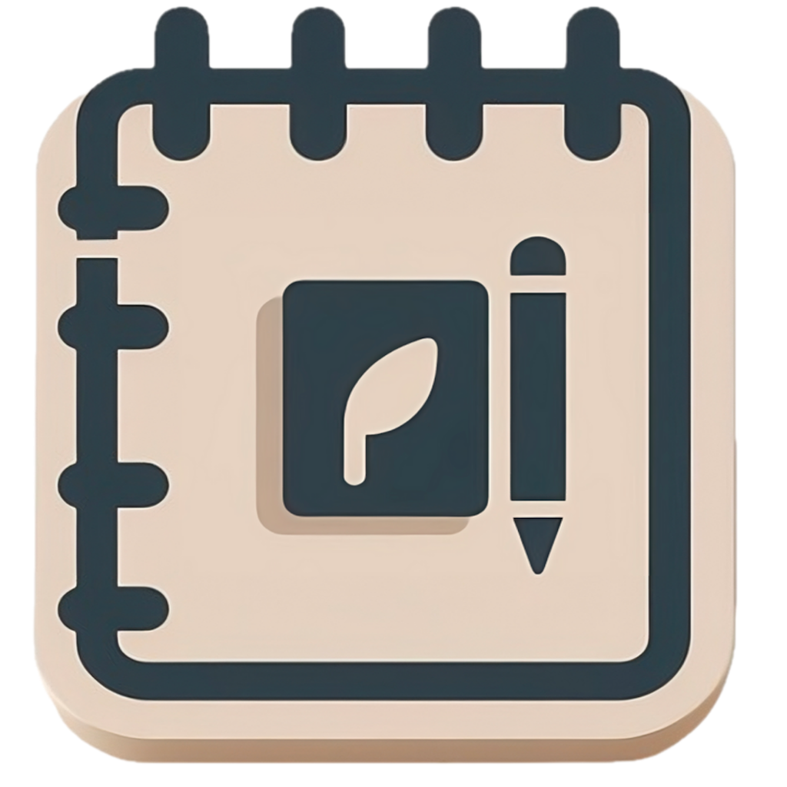

<div align="center">
  

  <h1>Superdiary</h1>

  <p><strong>A little space for your everyday.</strong></p>
  <p>A diary built with Kotlin Multiplatform and Compose Multiplatform.<br />
  Write, revisit, and find the moments worth keeping.</p>

  <p>
    <a href="https://github.com/rafsanjani/superdiary/actions/workflows/post-merge.yml"></a>
    <a href="#under-the-hood"></a>
    <a href="LICENSE"></a>
  </p>

  <p><a href="#a-look-inside">Preview</a> &nbsp;·&nbsp; <a href="#the-everyday-details">Features</a> &nbsp;·&nbsp; <a href="#get-started">Get started</a> &nbsp;·&nbsp; <a href="#testing">Testing</a></p>
  <p><sub>Android · iOS · Desktop</sub></p>
</div>

## A look inside

<table>
  <tr>
    <th width="33%">Your day at a glance</th>
    <th width="33%">Room to write</th>
    <th width="33%">Your own setup</th>
  </tr>
  <tr>
    <td align="center">
      <picture>
        <source media="(prefers-color-scheme: dark)" srcset="feature/diary-dashboard/src/androidHostTest/snapshots/images/com.foreverrafs.superdiary.dashboard_DashboardScreenSnapshotTest_Dashboard_Screen_-_Latest_Entries%5BPIXEL_6_DARK%5D.png" />
        
      </picture>
    </td>
    <td align="center">
      <picture>
        <source media="(prefers-color-scheme: dark)" srcset="feature/create-diary/src/androidHostTest/snapshots/images/com.foreverrafs.superdiary.creatediary_CreateDiarySnapshotTests_Create_Diary_Screen_-_with_content%5BPIXEL_6_DARK%5D.png" />
        
      </picture>
    </td>
    <td align="center">
      <picture>
        <source media="(prefers-color-scheme: dark)" srcset="feature/diary-profile/src/androidHostTest/snapshots/images/com.foreverrafs.superdiary.profile_ProfileScreenSnapshotTest_Profile_Screen_-_Idle%5BPIXEL_6_DARK%5D.png" />
        
      </picture>
    </td>
  </tr>
</table>

<p align="center"><sub>Current Android UI, captured with Paparazzi. The gallery follows your light or dark appearance.</sub></p>

## The everyday details

- **Write in your own way.** Rich text formatting, optional location tags, and AI-assisted drafts.
- **Find a moment again.** Search entries, filter by date, and save favorites.
- **See the bigger picture.** Weekly summaries, entry counts, and writing streaks.
- **Make it feel like yours.** Light and dark appearances, with configurable dashboard cards.

> **A work in progress.** Superdiary is a personal playground for multiplatform architecture, shared UI, and testing. Features and platform support continue to evolve.

## Get started

For Android development, use **JDK 21**, **Android SDK 37**, and Android Studio.

**1. Get the source**

```sh
git clone https://github.com/rafsanjani/superdiary.git
cd superdiary
```

**2. Add your local configuration**

```sh
cp secrets.defaults.properties secrets.properties
```

Fill in the services you plan to use. Authentication and remote diary data use Supabase; Google sign-in, maps, and AI features need their corresponding credentials. The keys are listed in [the configuration template](secrets.defaults.properties). `secrets.properties` is ignored by Git.

**3. Build the Android app**

Open the project in Android Studio, let it locate your Android SDK, then build the standard debug app:

```sh
./gradlew :androidApp:app:assembleStandardDebug
```

<details>
  <summary><strong>Working on another target?</strong></summary>

  <p>The iOS host is in <a href="iosApp">iosApp</a>; open <a href="iosApp/iosApp.xcodeproj">iosApp.xcodeproj</a> on macOS with Xcode and configure signing and service credentials for your environment.</p>
  <p>The desktop target lives in <a href="desktopApp">desktopApp</a>. Both hosts use the shared Kotlin modules described below.</p>
</details>

## Under the hood

Shared Kotlin and Compose code sit behind platform-specific app hosts. Koin wires dependencies, SQLDelight handles local persistence, and Supabase provides authentication and remote data.

| Area | Where to look |
| --- | --- |
| App hosts | [Android](androidApp) · [iOS](iosApp) · [Desktop](desktopApp) |
| User-facing features | [Writing](feature/create-diary) · [Dashboard](feature/diary-dashboard) · [Diary list](feature/diary-list) · [Favorites](feature/diary-favorite) · [Insights](feature/diary-insights) |
| Shared UI | [Design system](design-system) · [UI components](core/ui-components) · [Navigation](navigation) |
| Data and services | [Shared data](shared-data) · [Database](core/database) · [Authentication](core/authentication) · [AI](core/diary-ai) |
| Development tools | [Test utilities](common-test) · [Convention plugins](build-logic) · [Preferences](preferences) |

## Testing

Run Android host tests. Add `-Pkover koverXmlReport` to generate a coverage report.

```sh
./gradlew testAndroidHostTest
```

Verify committed screen snapshots with Paparazzi, without an emulator:

```sh
./gradlew verifyPaparazzi
```

After an intentional UI or renderer change, record updated snapshots:

```sh
./gradlew recordPaparazzi
```

Review new goldens in each feature's `src/androidHostTest/snapshots/images` before committing them. The PR snapshot job uploads reports and failure diffs as workflow artifacts.

---

<p align="center">Made by <a href="https://github.com/rafsanjani">Rafsanjani Aziz</a> · <a href="LICENSE">MIT licensed</a></p>
